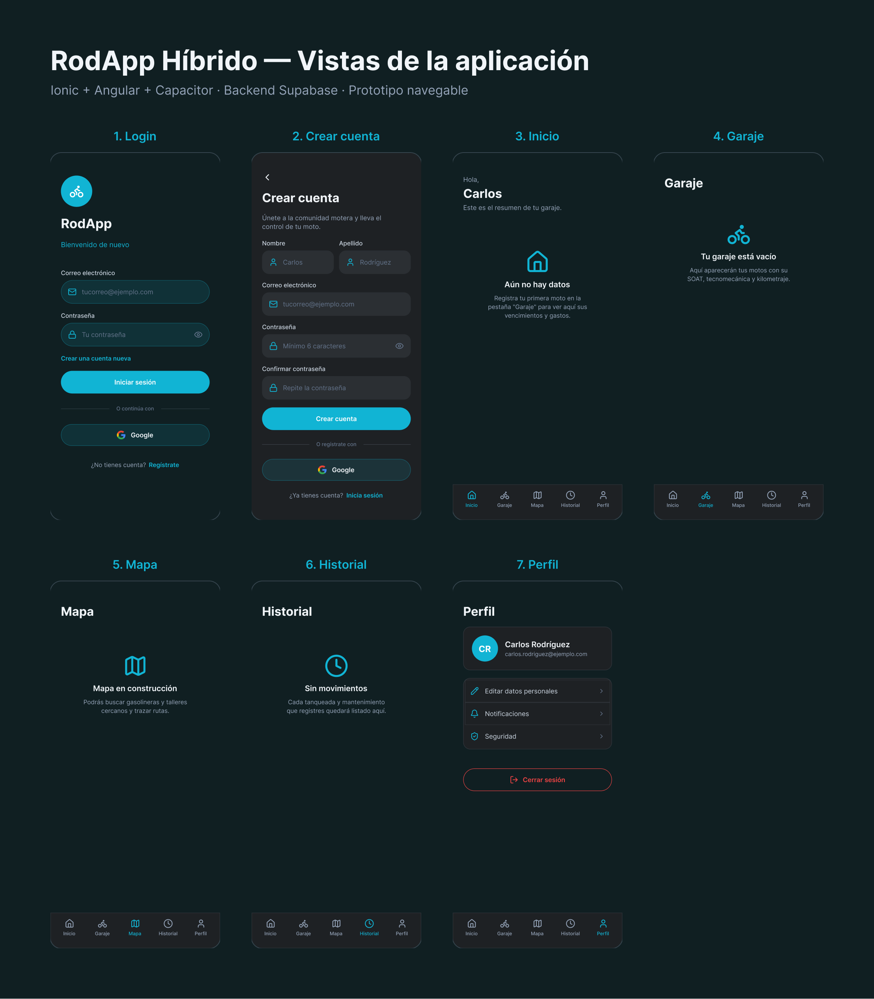

# RodApp
## Feedback y validaciones

Garaje, documentos, historial y formularios de acceso

*Lámina de mockups existente; no representa capturas runtime de esta entrega.*

---

## Feedback durante las operaciones

- `ion-loading` durante login, registro, carga de listas, guardado y borrado.
- Toast de éxito tras guardar, actualizar o eliminar.
- Toast de error distingue fallos de red de errores de configuración/backend.
- Confirmación antes de borrar una motocicleta.

---

## Garaje

- Listado de motos conectado a Supabase.
- Alta y edición en modal, con marca, modelo, placa, cilindrada y kilometraje.
- Placa obligatoria de 5 a 8 caracteres alfanuméricos o guion.
- Kilometraje obligatorio, entero y no negativo.
- Estado vacío con acción para registrar la primera moto.

---

## Documentos e historial

- Documentos agrega registros generales, SOAT y RTM por moto, con vencimientos.
- Estado vacío diferencia entre no tener moto y no tener documentos.
- Historial unifica tanqueadas y mantenimientos por fecha.
- Ambas listas muestran loading, error recuperable y acción de reintento.

---

## Verificación y requisitos

- `npm run build`: correcto.
- `npx ng test --watch=false --browsers=ChromeHeadless`: 2 pruebas correctas.
- La app web abre en `http://localhost:8100/login`.
- Para probar las listas y guardar datos deben estar creadas las tablas y políticas RLS descritas en `supabase/README.md`.
- No existe una fuente PPTX en el repositorio y no se generaron capturas privadas con datos simulados.